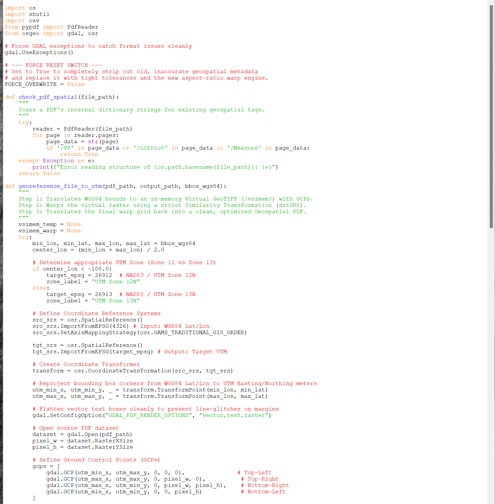
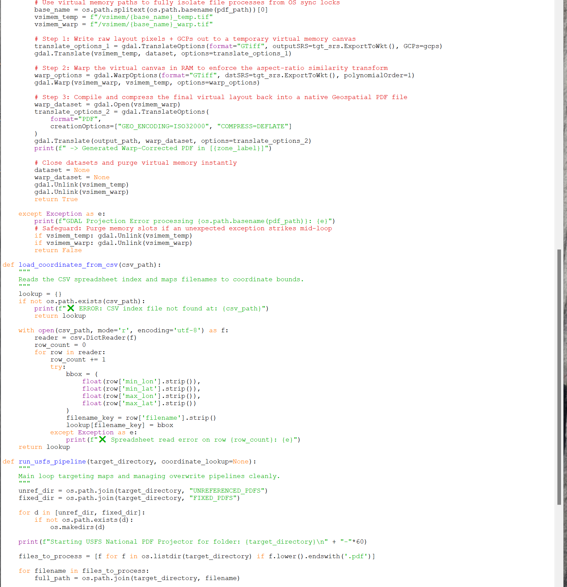
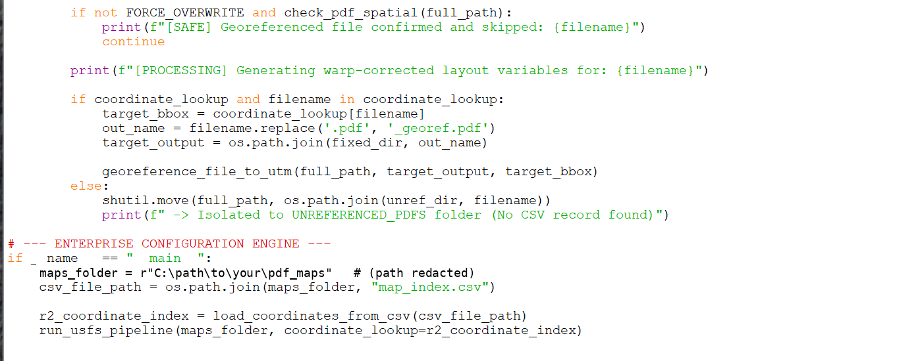

# Batch GeoPDF Georeferencer

A Python script that batch-converts folders of flat (non-spatial) PDF maps into **Geospatial PDFs** projected to NAD83 / UTM, using a simple CSV of bounding-box coordinates.

## The problem it solves
Georeferencing a PDF map by hand took about **45 minutes per map**. This script brings that down to about **3 minutes**, roughly a 93% time savings, and it can run across a whole folder unattended.

## What it does
1. **Scans** every `.pdf` in a folder and skips any that already carry geospatial tags (`/VP`, `/LGIDict`, `/Measure`), unless `FORCE_OVERWRITE = True`.
2. **Looks up** each map's WGS84 bounding box in a CSV index.
3. **Picks the UTM zone** from the map's center longitude: Zone 12N (EPSG:26912) west of -108°, otherwise Zone 13N (EPSG:26913).
4. **Georeferences** the page with four corner Ground Control Points, warps it in GDAL virtual memory (`/vsimem/`), and writes a compressed ISO 32000 Geospatial PDF to `FIXED_PDFS/` with a `_georef.pdf` suffix.
5. **Sets aside** any PDF with no CSV record by moving it to `UNREFERENCED_PDFS/` for review.

## Requirements
- Python 3 (developed on 3.11)
- [GDAL](https://gdal.org/) Python bindings (`osgeo`)
- [pypdf](https://pypi.org/project/pypdf/)

```bash
conda install -c conda-forge gdal pypdf
```

## How to use
1. Put your PDF maps in one folder.
2. Add a `map_index.csv` file to that same folder:

   ```csv
   filename,min_lon,min_lat,max_lon,max_lat
   example_map.pdf,-106.50,39.00,-105.75,39.60
   ```
   (Example values only. `filename` must exactly match the PDF's file name.)
3. Open `batch_geopdf_georeferencer.py` and set `MAPS_FOLDER` (and `CSV_INDEX_NAME` if needed) in the **CONFIGURATION** block.
4. Run it:
   ```bash
   python batch_geopdf_georeferencer.py
   ```
5. Find the results in `FIXED_PDFS/`. Check `UNREFERENCED_PDFS/` for any maps that still need a CSV entry.

> ⚠️ PDFs with no CSV record are **moved**, not copied, into `UNREFERENCED_PDFS/`. Work on a copy of your data.

## Screenshots
Script open in IDLE (title bars cropped and the local path redacted):





*Tip: a before/after image (a flat PDF next to the georeferenced output in a GIS) would make this section stronger.*

## Author
Kyle Knapp, GIS Specialist
